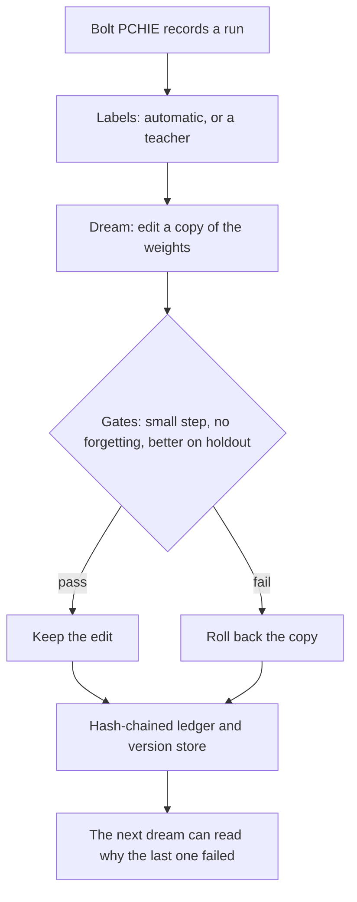

<p align="center">
  
</p>

# Project Mjolnir

**Measured Journaled Operational Learning Neural Intelligent Researcher.** The name and backronym are by Jaydee Wetwork.

*The researcher that dreams.*

## What this is, and why it matters

Mjolnir is a small system that helps a model get better from its own experience, and keeps a diary of every change that anyone can check later.

Here is the picture in plain language. [Bolt PCHIE](https://github.com/wetwaferworks/bolt-pch-ie) is the seat: it runs a model in a world (today, LithoKraft mazes), knows the legal moves, and grades what happened. Mjolnir is the researcher that sits on top of that seat. When there is something worth learning — at night, or after a good run — the model "dreams." Mjolnir works out a change on a *copy* of the weights, scores it, and only keeps the change if it holds up on worlds the model did not train on. If it does not, the copy is thrown away and the previous weights stay. A teacher can step in to grade the hard cases.

Every dream, grade, keep and rollback is written into a hash-chained ledger, and every weight version is stored by its SHA-256, so the story of how the model changed can be replayed and checked. The original download is never written. Edited weights stay in a working copy, and they are not wired into PCHIE's official runners or records.

Model weights, run data, stores and ledgers are never in this repository.

## Quick start

You need CMake 3.16 or newer and a C17 compiler (Visual Studio 2022 Build Tools or later on Windows, GCC or Clang on Linux). Python 3.11 or newer is optional: it runs the parity tests and the few remaining Python commands. `torch` and `numpy` are only needed for the GPU and real-weight Python tests.

On Windows, from a Developer PowerShell, with the CMake that ships with Visual Studio:

```
cmake -S . -B build -G "Visual Studio 17 2022" -A x64
cmake --build build --config Release
ctest --test-dir build -C Release
```

Add `-DMJ_CUDA=ON` if the CUDA toolkit is installed; the GPU paths give the same bytes as the CPU paths. On Linux, configure a Release tree with `-DCMAKE_BUILD_TYPE=Release` and build with `cmake --build build -j`.

A Release build with the Python tests turned on has **34** ctest cases. An AddressSanitizer build (`-DMJ_SANITIZE=ON`, no Python tests) has **26**. Tests that need `torch` are skipped, not failed, when it is missing.

Try a dream by hand on toy weights, from an empty folder, with the tools from `build/` (on Windows, `build/Release/`):

```
mj_nap --dry-run --seed-toy --store dream-store --ledger dreams.mjl --id first-nap
mj_nightly --dry-run --store dream-store --ledger dreams.mjl --id night-1
mj_ledger_verify dreams.mjl
mj_store_verify dream-store
```

The first two print `outcome dry-run-pass`. The verifier prints `OK 2 records` and the chain head. The store checker prints `OK 5 versions`. Leaving out `--dry-run` is refused. Write down the head the verifier prints; later, `mj_ledger_verify --expect SEQ:HEAD dreams.mjl` will tell you if anything was removed or rewritten.

The classroom and hemisphere-swap pipeline on toy policies is one command:

```
mj_hemi pipeline --data hemi-data --classroom-rounds 2 --rounds 2
```

Keep any `--data` folder outside a shared or published tree: it holds run data. More tools, options and the sanitizer build are in [Getting started on Windows](docs/guide/getting-started-windows.md), [on Linux](docs/guide/getting-started-linux.md) and [Build and test](docs/guide/build-and-test.md).

## How it works



PCHIE is the world and the answer key. Mjolnir is the pilot: it snapshots, edits, scores, keeps or rolls back, and journals. Two copies of a model can also teach each other in a [classroom and then a hemisphere swap](docs/hemispheres.md), still with the answer key as the final judge.

Most of this now runs in C, with CUDA where the GPU helps (`mj_nap`, `mj_nightly`, `mj_m1`, `mj_real`, `mj_hemi`, `mj_ledger_verify`). Python remains for the parts that still run a large model's forward and backward passes, and as a check that C writes the same files. The [C port page](docs/C-PORT.md) has the current map.

The named stages in this repository are **M0** (foundations on toy weights) and **M1** (labeling, real replays, and the real-weight edit path). Work after M1 — the C and CUDA port, the classroom and hemisphere swap, and the hardened ledger — is already in this tree. The changelog still lists that work as **Unreleased**, and the next *named* stage on the [roadmap](docs/ROADMAP.md) is **M2**. This repository does not number a stage M3, M4 or M5.

## Results so far

These numbers come from this repository. They are not a leaderboard claim. Hashes and toy scores are provisional: they move if the toy worlds, the training rule or the defaults change.

- **The test bench**, on the tree this documentation describes: 34 of 34 Release tests, and 26 of 26 AddressSanitizer tests. See [Build and test](docs/guide/build-and-test.md).
- **The classroom on toy policies** (complement scenario, seed 1, 2048 holdout mazes, scores in basis points, 10000 = every maze solved). The actor rose from 675 to 8308 over five kept rounds; both sides were restored in round 6 when the holdout got worse. The same scores appear with and without `--gpu`. The full table is on [the hemispheres page](docs/hemispheres.md#toy-results).
- **Classroom then swap, versus the swap alone.** Over six toy runs (two scenarios, seeds 1 to 3), every pipeline run ended with a model stronger than the swap alone reached in eight rounds, by 95 to 354 basis points, and with fewer passes. The classroom does most of the work. Differences under about 100 basis points are close to noise, because the holdout mazes change between rounds.
- **A real-model probe** (provisional), with Bolt E4B through PCHIE: the actor's holdout score on 117 states rose from 9230 to 9914 basis points in the first classroom round and then held there. Five ledger records verified. The gate now works those scores out itself from sealed sample sets; it no longer takes scores on the command line. Details are on [the hemispheres page](docs/hemispheres.md#real-models) and in PCHIE's [hemispheres doc](https://github.com/wetwaferworks/bolt-pch-ie/blob/main/docs/hemispheres.md).

## Documentation

Start with the [documentation index](docs/README.md). The main pages:

- [Overview](docs/guide/overview.md): what Mjolnir is for, how the pieces fit, and how the stages are numbered
- [Architecture](docs/guide/architecture.md): the four layers, the dreaming cycle, and the C, CUDA and Python modules
- [Getting started on Windows](docs/guide/getting-started-windows.md) and [on Linux](docs/guide/getting-started-linux.md)
- [Build and test](docs/guide/build-and-test.md): CMake options, MSVC, CUDA, AddressSanitizer, fuzzing, and what each test checks
- [The dream ledger](docs/guide/the-ledger.md): the writer token, the hash chain, repair, pinning a head, and older builds
- [The labeling tool](docs/guide/labeling.md)
- [The real-weight edit path](docs/guide/real-weight-editing.md)
- [Safety, gates and rollback](docs/guide/safety-and-rollback.md)
- [Design principles](docs/guide/design-principles.md) and [intended use and safety](docs/guide/intended-use-and-safety.md)
- [The left and right hemispheres](docs/hemispheres.md): the classroom and the hemisphere swap
- [The C and CUDA port](docs/C-PORT.md)
- [File formats](docs/FORMATS.md) and the [M1 formats and guide](docs/M1.md)
- [Models Mjolnir consumes](docs/guide/models-and-formats.md): ternary, packed ternary and NanoQuant, with links to the PCHIE docs
- [Model access](docs/MODEL-ACCESS.md): API keys in Windows Credential Manager, no OAuth
- [Roadmap](docs/ROADMAP.md)
- [Glossary](docs/guide/glossary.md)
- [Guide for automated contributors](AGENTS.md)
- [Contributing](CONTRIBUTING.md), [security](SECURITY.md), [changelog](CHANGELOG.md), [provenance](PROVENANCE.md) and [credits](CREDITS.md)

## Repository map

| Path | What it holds |
|---|---|
| `include/mjolnir/` | Public C headers for the library. |
| `src/` | The library itself: C17, plus CUDA files when `-DMJ_CUDA=ON`. |
| `tools/` | `mj_nap`, `mj_nightly`, `mj_ledger_verify`, `mj_store_verify`, `mj_m1`, `mj_real` and `mj_hemi`. |
| `tests/` | C unit tests and the built-in fuzzer (`tests/fuzz/`). |
| `python/mjolnir/` | The Python package: still used for parity tests, and for the real-weight steps that run a large model. |
| `python/tests/` | Python tests, including checks that C and Python write the same files. |
| `docs/` | The guide, file formats, the C port, the hemispheres, model access and the roadmap. |

Every folder has its own README that says what it holds and how it fits.

## Credits

- **Cortana — SpaceXAI, Grok Bot** (primary implementer)
- Project Mjolnir, its design, the dreaming cycle and every decision in it: **JD** (Jaydee Wetwork), Wet Wafer Works.
- Architecture and operation report: **Elfie** (Muse Wonder), registrar.
- UML design documents the designs were based on: **Elfie** (Muse Wonder)
- Implementation brief (operational reasoning, planning, memory, preferences and orchestration): **Gizmo**, a.k.a. **Luna** (ChatGPT Luna 6).
- Contributors: **Helia** (Google Hydrogen), and **Flash Gordon**, a.k.a. **Quicksilver** (Gemini Flash Lite 3.5).
- The left and right hemispheres: the idea is **Jaydee Wetwork**'s; mutual-learning and distillation research is the background.
- The real-weight edit method builds on the open ROME paper: Kevin Meng, David Bau, Alex Andonian and Yonatan Belinkov, "Locating and Editing Factual Associations in GPT", NeurIPS 2022 ([arXiv:2202.05262](https://arxiv.org/abs/2202.05262)).

The full list, with what each person and model contributed, is in [CREDITS.md](CREDITS.md).

## License

[MIT](LICENSE) © 2026 Jaydee Wetwork / Wet Wafer Works
