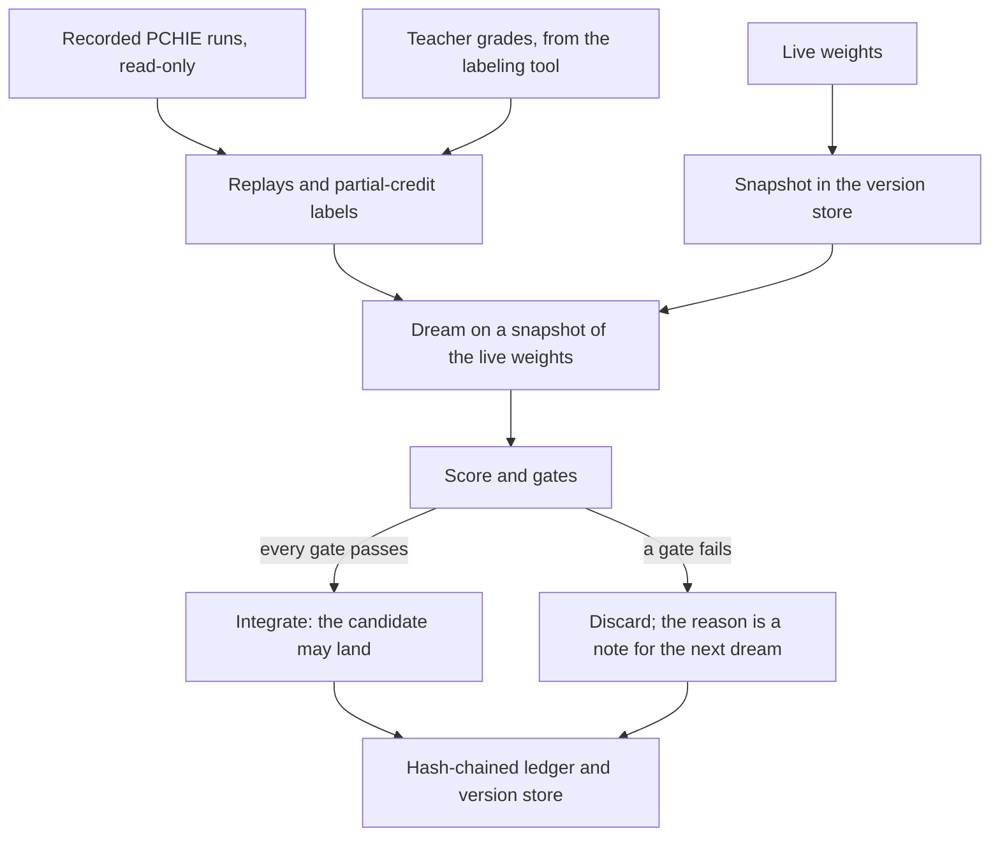

# Overview

Mjolnir improves a model's weights through guided dreaming, with every change recorded, checked and reversible.

**The problem.** A model that plays a task (for now, LithoKraft mazes run through Bolt PCHIE) makes good moves and bad ones. We want it to get better from its own experience, without forgetting what it already knows, and without any change slipping in unrecorded or unchecked.

**The approach.** At night, or after something worth learning, the model dreams. A candidate change is worked out on a copy, scored with partial credit, and gated: it has to stay small, keep behavior on a golden set nearly unchanged, keep the golden score, and improve the task. Only then may it land. Every dream, grade and edit is a line in a [hash-chained ledger](the-ledger.md), and every weight version is stored by its SHA-256 so any earlier version, including the untouched original, can be restored.

**The teacher stays in the loop.** A person labels data, grades outcomes and decides what counts as productive. The loop is guided recurrence, never full recursion.

**Two models can teach each other.** In the [classroom](../hemispheres.md), one side acts while the other watches and grades; each learns from its own mistakes. In the hemisphere swap, both sample sets are combined into a child that is kept only if it beats both parents. The answer key (PCHIE) is the final judge throughout.

## How the pieces fit

PCHIE is the seat and the answer key. Mjolnir is the researcher around that seat. An edited model stays in its working copy; nothing here writes to PCHIE's official runners.

## How the stages are numbered

This repository names two stages, and it has not numbered anything after them.

| Stage | Status | What it covers |
|---|---|---|
| M0 | Named, in this repository | Foundations on toy weights: store, ledger, scorer, update rule, dream drivers. Dry runs only. |
| M1 | Named, in this repository | Labeling tool, real replays, toy training from those replays, real-weight edits on a working copy. First written in Python, now mostly ported to C and CUDA. |
| Work after M1 | In this tree, listed as **Unreleased** in the [changelog](../../CHANGELOG.md) | The rest of the C and CUDA port (including `mj_m1` and `mj_real`), the classroom and hemisphere-swap pipeline (`mj_hemi`), the gate for real models, and the hardened ledger (writer token, torn-tail repair, `--expect`). |
| M2 | Planned, see the [roadmap](../ROADMAP.md) | A live PCHIE watching and verifying edits on the working copy before they count; the hemispheres on real models; hand-labeled grades feeding real-weight dreams. |

There is no stage called M3, M4 or M5 in this repository. If a larger milestone number would help as a shorthand, it has not been written into the changelog or the code. This guide follows the names the history already uses.

## What Mjolnir is not

- It is not a training framework for large models. The real-weight path makes small, low-rank, gated edits.
- It does not touch PCHIE's official runners or records. An edited model stays in its working copy.
- It does not store weights, run data or ledgers in this repository.
- It does not give the model tools. The model only plays the game it is being taught.
- It does not convert or pack models. Ternary, packed ternary and NanoQuant are prepared by PCHIE; Mjolnir [consumes them](models-and-formats.md).

Next: [Architecture](architecture.md).
