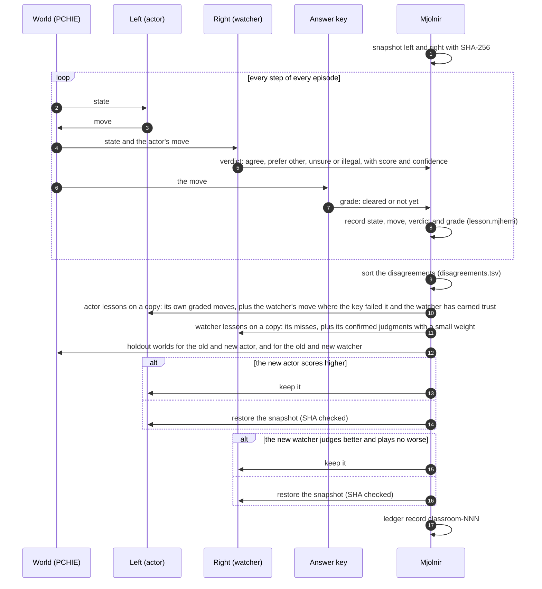
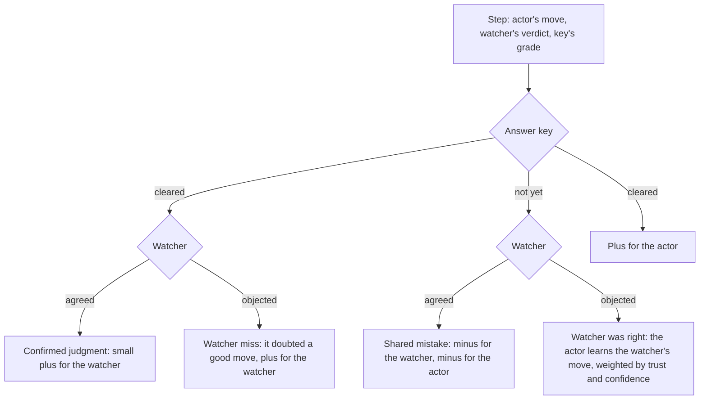
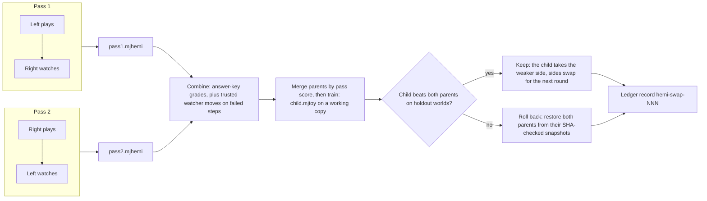
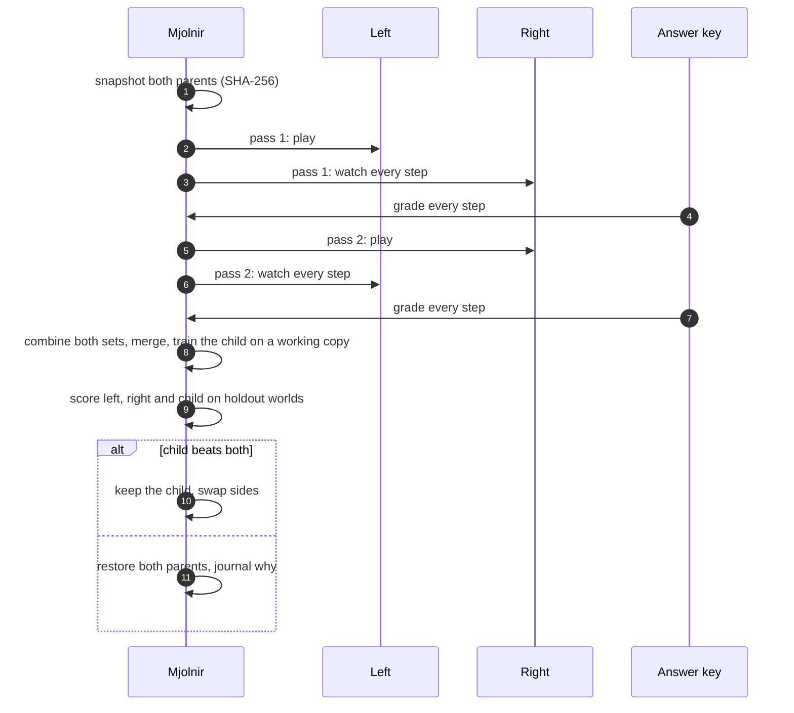
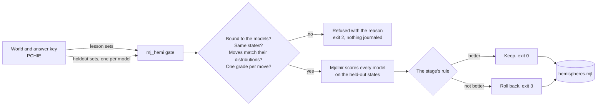

# The left and right hemispheres

The idea is Jaydee Wetwork's: two copies of a model, a left and a right hemisphere, teach each other, and Mjolnir keeps the result only when the world says it is better. It runs as a pipeline in two stages:

1. **The classroom** (`mj_classroom`). The left hemisphere acts in a world while the right one watches, grades every move and flags mistakes. Mjolnir finds where the actor erred and where the watcher was wrong, and each side learns from exactly those disagreements.
2. **The hemisphere swap** (`mj_hemisphere_swap`). Each side plays while the other watches. Mjolnir combines both sample sets into one new model and keeps it only if it beats both parents. Then the sides swap and the next round starts.

The classroom runs first. Its improved left and right become the parents of the swap, and the last model the swap keeps is the new model.

PCHIE is the world and the answer key: it runs the model, knows the legal moves and grades every step. Mjolnir is the pilot. It runs both stages, makes every change on a checksummed working copy, decides what is kept and writes everything into the journal.

## Design principles

1. **The answer key is always the final judge.** A watcher's opinion counts only where the answer key backs it, and only as far as that watcher has earned trust in the same lesson. Two models can never talk each other into the same mistake.
2. **Nothing changes in place.** Every update is made on a copy. The parents are snapshotted with their SHA-256 before anything runs, and every rollback checks the snapshot against that checksum before restoring it.
3. **Kept only if better on unseen worlds.** All gates use holdout worlds that neither side trained on.
4. **Everything is journaled.** Each lesson and round writes its sample sets (MJHEMI2), a `disagreements.tsv` and a hash-chained ledger record, so every decision can be replayed.
5. **Any model can take part.** A hemisphere is two functions: give a distribution over the legal moves of a state, and say what you are. The toy policy, a dense transformer, a mixture-of-experts model or a state-space hybrid all fit the same slot. Nothing assumes one model's layer layout.

## Stage 1: the classroom





The four judgments the answer key can confirm or refute:

| Watcher said | Key said | What it is | Watcher target | Actor target |
|---|---|---|---|---|
| agree | cleared | confirmed | +0.25 on the move | +1.0 on the move |
| agree | not yet | shared mistake (a watcher miss) | -1.0 on the move | -0.5 on the move |
| objected (prefer other or illegal) | cleared | the watcher doubted a good move (a miss) | +1.0 on the move | +1.0 on the move |
| objected | not yet | the watcher was right | -0.25 on the move | -0.5 on the move, and +0.75 × trust × confidence on the watcher's move |

An "unsure" verdict, where the watcher's top two moves are within 10% of each other, judged nothing and teaches the watcher nothing. Trust is `max(0, 2 × right / judged - 1)` over the lesson: a watcher that is right only half the time earns no say at all.

The gates are separate for the two sides, both on holdout worlds:

- **Actor:** the new left must score higher than the old left.
- **Watcher:** the new right must have more of its judgments confirmed by the answer key, with the old left acting both times so the comparison is fair. Its own play score must not drop, so sharpening the critic never costs the player.

## Stage 2: the hemisphere swap





## Guardrails

- The answer key is the only source of a target's sign. Watcher moves are hints, weighted by earned trust and by the watcher's confidence.
- Model originals are read-only. Every edit lands on a checksummed working copy, and the original's checksum is the rollback.
- Every sample set is MJHEMI2 (see [FORMATS.md](FORMATS.md)): versioned, bounds-checked on read, records strictly ordered, sealed with a SHA-256. The parser has a fuzz target (`hemi` in `mj_fuzz`), and the classroom's watcher lessons are fuzzed on every parsed set.
- No score is taken on anyone's word. For real models, Mjolnir works every score out itself from holdout sets that are bound by SHA-256 to the models in the decision, and refuses evidence that does not hold together (see [The gate for real models](#the-gate-for-real-models)).
- No locks. A round runs on one thread. The only hand-offs are phase boundaries: lesson or passes, combine, train, evaluate, journal.
- The GPU only scores. The holdout scorer has a CUDA path (`--gpu`) that gives the same answers bit for bit as the CPU path; the tests check this on every build with CUDA.
- Every round is repeatable bit for bit from its seed, on Windows and on Linux.
- Hashes in this page and in run folders are provisional. They move whenever the toy worlds, the training rule or the defaults change.

## Running it

```
mj_hemi pipeline --data DIR [--classroom-rounds 6] [--rounds 8] [--scenario complement|ternary] [--seed S] [--gpu]
mj_hemi classroom --data DIR ...     stage 1 only
mj_hemi swap --data DIR ...          stage 2 only
mj_hemi show DIR/classroom-001/lesson.mjhemi
mj_hemi replay DIR/swap-001/pass1.mjhemi --limit 20
mj_hemi bench [--states N]           CPU against GPU scoring
```

Each round gets a folder (`classroom-NNN/` or `swap-NNN/`) with the parents' snapshots, the candidates, the sample sets and `disagreements.tsv`. Everything is journaled in `DIR/hemispheres.mjl` (check it with `mj_ledger_verify`).

The two toy scenarios start from different pairs of parents:

- **complement:** each parent knows half of the teacher's rules, so neither can solve a maze alone.
- **ternary:** the left is the teacher squeezed to three levels per weight, the way the ternary converter squeezes a real model; the right is a noisy copy at full precision.

## Toy results

Holdout scores are basis points of partial credit (10000 = every maze solved), on 2048 holdout mazes. They came from the run folders of 19 November 2026, are provisional, and are identical with and without `--gpu`.

**Stage 1, the classroom** (complement scenario, seed 1). Both sides improved in rounds 1 to 5. In round 6 both updates were worse on the holdout and both were restored.

| Round | Actor before → after | Watcher judgments confirmed | Watcher's own play |
|---|---|---|---|
| 1 | 675 → 5522 kept | 8604 → 9136 kept | 1940 → 3903 |
| 2 | 5379 → 7283 kept | 9079 → 9612 kept | 3980 → 6089 |
| 3 | 7314 → 8096 kept | 9606 → 9770 kept | 5979 → 7397 |
| 4 | 8054 → 8188 kept | 9805 → 9851 kept | 7400 → 8329 |
| 5 | 8198 → 8308 kept | 9844 → 9891 kept | 8325 → 8785 |
| 6 | 8451 → 8375 restored | 9885 → 9879 restored | 8836 → 8439 |

**Stage 2, the swap after the classroom.** The swap starts from much stronger parents and has less to add. Over seeds 1 to 3 and both scenarios:

| Scenario, seed | Classroom rounds that changed a side | Swap rounds kept | Best swap child | The same seed with the swap alone (8 rounds) |
|---|---|---|---|---|
| complement 1 | 5 of 6 | 0 of 2 (stopped) | none beat the right parent (8857) | 8503 |
| complement 2 | 6 of 6 | 1 of 3 | 8528 | 8279 |
| complement 3 | 6 of 6 | 1 of 3 | 7682 | 7518 |
| ternary 1 | 5 of 6 | 1 of 4 | 8692 | 8542 |
| ternary 2 | 6 of 6 | 0 of 2 | none beat the right parent (8461) | 8272 |
| ternary 3 | 6 of 6 | 0 of 2 | none beat the right parent (7554) | 7459 |

What this shows, honestly:

- Every pipeline run ended with a model stronger than the swap alone reached in 8 rounds (by 95 to 354 basis points), using fewer passes: a classroom round plays one pass, a swap round two. The classroom does most of the work. The holdout mazes differ between rounds, so differences under about 100 basis points are close to noise.
- The classroom often leaves the watcher a better player than the actor, because the watcher learns from every graded move of the actor's play. When that happens, the swap child (a blend of both) rarely beats the stronger parent, and the gate correctly rolls it back.
- Ablations on the swap alone (seeds 1 to 3) show its gain comes mostly from the answer-key-graded samples of both passes. The watcher hints and the weight merge are close to neutral. For example, complement seed 1, round 1: default 6239, without watcher hints 6650, without the merge 5755, without both 6686. Trust-weighting the hints cut their harm: the same round scored 5698 before trust was added.

## Real models

The hemisphere interface is the seam for real models. A real hemisphere only has to give a distribution over the legal moves of a PCHIE world state. For a text model, that is the next-token probabilities of the move names, renormalised over the legal moves. The left and right can be the same network at two precisions (for example a ternary copy and the full-precision original), which is how Little Super Nemo (from Nemotron 3.5 Super VL, a Mamba-2, mixture-of-experts and attention hybrid) is meant to take part. Weight edits for real models go through Mjolnir's working copy, never the original. See [C-PORT.md](C-PORT.md) for the real-weight path.

### The gate for real models

Mjolnir cannot run a large model itself, so for a real model the world outside Mjolnir plays the rounds and asks `mj_hemi gate` (the `mj_hemi_gate` library) for every decision. It does not pass any score. It passes sealed sample sets, and Mjolnir works the scores out from them:

- **lesson sets** (purpose 1): what the round learned from;
- **holdout sets** (purpose 2): the same held-out states played by each model the decision needs, every move graded by the answer key, plus, for a watcher, the lesson's actor watched by the old and the new watcher.



Every set names the full SHA-256 of the model that acted and the model that watched (for a real model, the SHA-256 of its working copy's edited weights). The gate refuses, with the reason and without journaling anything, when:

- a lesson set was not played (actor stage) or watched (watcher stage) by the parent, or for a swap is not between the two parents, or a swap has no pass played by each parent;
- a holdout set is marked as a lesson, or the other way round, or a lesson uses the holdout seed;
- the holdout sets are not on the very same states (episode, step and features);
- a recorded move is not the one its recorded distribution picks, or a verdict does not match the watcher's distribution;
- the answer key graded the same move on the same state two ways in two sets;
- two sets played by the same model disagree on its play;
- there is no holdout set played by a model the decision needs.

Then the rules are the toy stages' rules on Mjolnir's own numbers: an actor is kept when it plays the held-out states better than its parent; a watcher when the answer key confirms more of its judgments of the lesson's actor and its own play is no worse; a swap child when it beats both parents. Exit 0 keeps, 3 rolls back, 2 refuses, 1 means a set could not be read. The rules and every refusal are tested in `test_hemi`, and the gate runs inside the hemisphere fuzz target.

What the gate still has to take on trust is the world's answer key itself: Mjolnir checks that the key is consistent across sets, not that each grade is right. That is by design (the answer key is the final judge), and it is why the key lives in PCHIE's deterministic, tested world code.

### Results on Bolt E4B

The reviewed run (Mjolnir working out every score from holdout sets bound to each tail's SHA-256) is being repeated after the review fixes; its results will replace this paragraph.

**The first run, before the review fixes** (PCHIE passed the scores on the command line; kept as history). Bolt E4B through PCHIE, with the ternary tail of layers 38 to 41 as the left and the Q4 tail as the right, and the line between them as the only edit. Results on 117 holdout states (basis points cleared by the answer key):

| Stage | What happened | Mjolnir |
|---|---|---|
| Classroom 1 | Actor t=0 to t=3/8, 9230 to 9914. Watcher t=8/8 to t=5/8, judgments 9230 to 9914 | keep, keep |
| Classroom 2 | No disagreements left; no candidate improved | roll back, roll back |
| Swap 1 | Child t=4/8 at 9914 ties both parents | roll back |
| New model | t=3/8, 9914 bp, tail SHA-256 646e25c4... (provisional) | 5 records, chain verified |

The details, the probe and what is still missing are on PCHIE's `docs/hemispheres.md`.

## Background and credits

- The idea, the two-stage pipeline and the names: **Jaydee Wetwork**, Wet Wafer Works.
- Background: published research on two networks learning from each other (deep mutual learning), on knowledge distillation and self-distillation, and on teacher-student and actor-critic training. This code is a clean-room build from the ideas in those papers. No code from them was used.
- License: MIT.
